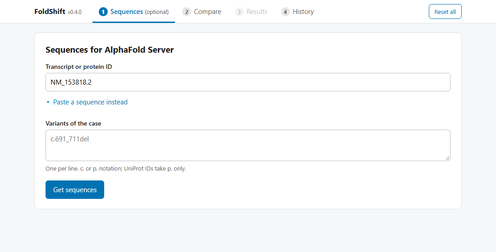
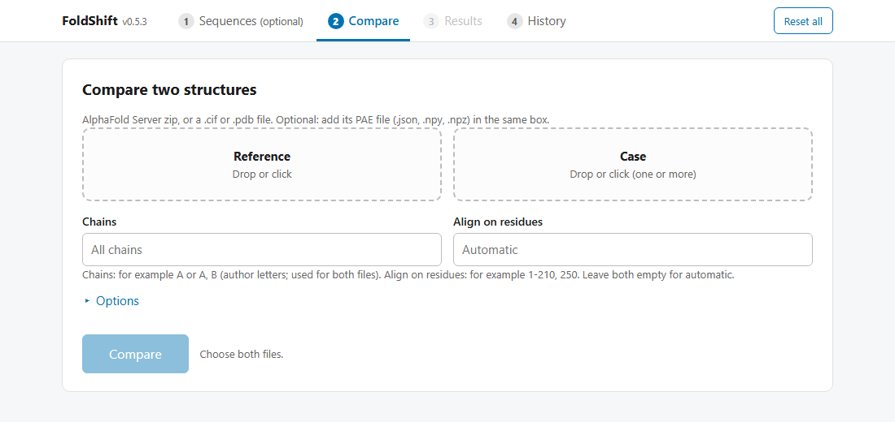
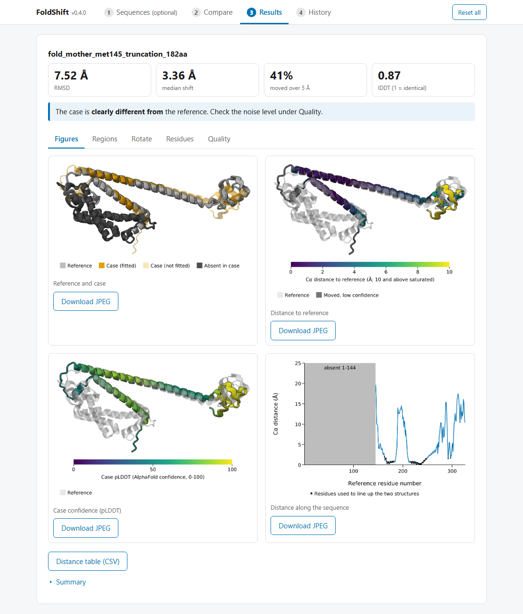

# FoldShift

**See what a variant does to a predicted protein structure.** Version 0.5.3 · MIT license · Status: stable for daily use, Windows exe tested; macOS build and native window not tested yet.

FoldShift compares two predicted structures of the same protein, a reference and a case (for example a patient variant). It lines them up, measures how far each residue moved, and draws four figures ready for a paper (88 mm wide, 600 dpi JPEG). It also prepares the reference and case protein sequences you paste into AlphaFold Server. It never predicts structures itself.

It is for clinical geneticists and biologists who need a quick answer without installing Python, PyMOL, or ChimeraX. It is one small program with a browser page: no installation, no account, no command line.

## Get started

1. **Download** the program from the Releases page: `FoldShift_v0.5.3_windows_x64.exe` for Windows (a macOS Apple Silicon build is made by the GitHub workflow). No other software is needed.
2. **Double-click it.** Your browser opens the FoldShift page. Windows SmartScreen or macOS Gatekeeper may warn on first start because the program is unsigned; choose "Run anyway".
3. **Try it with the sample files** in the `test/data/` folder of the repository (open data, see `test/data/README.md`): open the **Compare** tab, drop `fold_hba_reference.zip` in **Reference** and `fold_hba_case.zip` in **Case** (human HBA1 and its variant `c.179G>A`, p.Gly60Asp), and press **Compare**. The result opens in about a second.
4. **Close the browser tab** to quit. Your comparison history is deleted when the program closes.

## The four steps

The page has four tabs. Work from left to right. **Reset all** (top right) deletes every comparison and result of this session, clears the form, and starts clean; the downloaded transcript data stays. It waits while a comparison is running.

**1. Sequences** (folded by default; skip it if you already have the sequences)

- Enter a RefSeq transcript (`NM_000558.5`), an Ensembl transcript (`ENST00000320868.9`), or a UniProt accession (`P69905`; protein variants only). You can paste a DNA or protein sequence instead.
- Enter the case variants: `c.179G>A`, `c.1A>G`, or `p.Val56_Lys62del`.
- Copy the reference and case proteins into AlphaFold Server and run them as two jobs. Download both result zips and do not unzip them.
- Not supported yet: intron or untranslated region (UTR) positions, protein frameshifts, and gene symbols.

**2. Compare**

- Drop the reference and one or more cases. Each can be an AlphaFold Server zip, or a `.cif` or `.pdb` file from any tool (ColabFold, ESMFold, Boltz, Chai-1, the AlphaFold database, or an experimental structure). Several cases are compared with the same reference.
- Optional: drop a predicted aligned error (PAE) file (`.json`, `.npy`, or `.npz`) next to its structure. FoldShift pairs it by file name and reports the mean PAE. Pickle files are refused because opening one can run code.
- Files with several chains (most experimental structures): type the chain letters, such as `A` or `A,B`, in **Chains**. Residue numbers you type anywhere are the numbers of the reference file (Phe508 is `508`), and results use them too. When both files are plain structures with the same numbering, residues are paired by number, so a disordered loop missing from one file cannot shift the pairing.
- Optional: type residues such as `1-210, 250` in "Align on residues" to choose which part is lined up. Leave it empty for automatic. "Zoom on residues" fades the rest and fills the picture with the residues you type.
- Press **Compare**. A zip uses its best-ranked model; a plain file is used as it is.

**3. Results** (one block per case; a verdict and four numbers on top: root-mean-square deviation (RMSD), median shift, share of residues moved over 5 Å, lDDT)

- **Figures:** the four figures, each with its own **Download JPEG** button: reference and case, distance to reference, case confidence (pLDDT), and distance along the sequence. The **Distance table (CSV)** button saves the per-residue table. The **Summary** list explains the result in plain words.
- **Regions:** the aligned blocks with their RMSD alone and after the global fit. One click lines the structures up on a block, and "Automatic alignment" goes back.
- **Rotate:** drag to rotate and scroll to zoom; **Use in figures** redraws the four figures from this view.
- **Residues:** marked residues (your variants are marked automatically after step 1) and helix or strand changes.
- **Quality:** ranking score, pTM, mean pLDDT, and the noise between the reference's own models. A difference counts only if it is clearly larger than this noise.
- The run folder also holds `model_robustness.csv`, `summary.txt`, `summary.json`, and `case_aligned_to_reference.cif` (or `.pdb`).

**4. History**
- Reopen an earlier comparison of this session. In the Compare options, **Settings file → Save** stores your options in a JSON file that **Load** brings back later.

## Notes

- Mixed sources: if the reference and case come from different prediction tools, the summary warns that part of the difference may come from the method, not from the variant.
- No confidence values: experimental structures and files whose B-factors are not pLDDT are treated as fully confident, and the confidence figure is skipped. B-factors between 0 and 1 are read as pLDDT divided by 100.
- Start loss (`c.1A>G`) assumes translation starts at the first downstream in-frame Met. Check this for your gene.
- Internet: only the transcript lookup needs it (National Center for Biotechnology Information, NCBI, Datasets API first, NCBI E-utilities as a fallback; Ensembl; UniProt). Comparison works offline.
- Where files go: `%LOCALAPPDATA%\FoldShift` (Windows), `~/Library/Application Support/FoldShift` (macOS), `~/.local/share/FoldShift` (Linux). Set `PSPLOT_HOME` to change it.
- Speed: a full comparison with four figures takes about 0.7 s on a 6-core computer (test data).

## Shared server (optional)

A lab can run FoldShift once in a container and let colleagues open it in a browser, with nothing installed on their PCs. Setup, settings, and limits are in [docs/SERVER.md](docs/SERVER.md).

## Examples

Ten comparisons of real structures (CFTR, BRAF, KRAS, hemoglobin, p53, T4 lysozyme, H-NOX) show each function with settings and results: [docs/EXAMPLES.md](docs/EXAMPLES.md).

## Methods and limits

FoldShift pairs residues by global alignment (Gotoh, BLOSUM62), lines up the structures by least-squares superposition (Horn) on well-predicted residues, and reports RMSD, lDDT-Cα, a TM-score lower bound, and secondary-structure changes. Helix and strand assignment, the pruning cutoff, and the "moved, low confidence" flag are our own rules and are not validated against benchmarks. Each method, its parameters, references with DOIs, and the list of unvalidated rules are in [docs/METHODS.md](docs/METHODS.md).

All code is written for this project. We chose the features by reading what PyMOL and ChimeraX offer. We do not copy, link, call, or ship any code of either program. The embedded font is DejaVu Sans (see `THIRD_PARTY_NOTICES.md`).

## Develop

    cargo test --workspace --release      # uses the open data in test/data
    cargo clippy --workspace --all-targets -- -D warnings && cargo fmt --check
    cargo run --release -p psplot -- --no-browser --port 8770
    CARGO_TARGET_DIR=<local dir> scripts/build_windows.sh   # Windows exes into dist/

The Rust toolchain is pinned in `rust-toolchain.toml`. macOS is built by `.github/workflows/release.yml` on a GitHub macOS runner. Report bugs or ask questions in the project's issue tracker.

## License

MIT, see `LICENSE`. Copyright 2026 Jen-Hsiang Ou.

## Contact

Maintainer: Jen-Hsiang Ou, Ph.D., Department of Medical Genetics, National Taiwan University Hospital, <oumark.me@outlook.com>. For bugs and feature requests, open an issue on GitHub.
