# Examples

Eight reference and case sets (ten comparisons) from the RCSB Protein Data Bank show every function of FoldShift on real structures. All numbers below were produced by FoldShift v0.5.0 with the settings listed in each section. The structure files are not part of the repository. Download them once:

    sh examples/fetch_examples.sh        # writes examples/data/*.cif and *.pdb

Then open the **Compare** tab, drop the reference and the case (several cases can be dropped together), type the **Chains** and the other options given for the example, and press **Compare**.

These are experimental structures. They carry no pLDDT, so FoldShift treats every residue as confident and skips the confidence figure. The sample zips and the AlphaFold DB model in `test/data/` cover pLDDT, pTM, the quality tab, and the model-to-model noise (see the [README](../README.md)).

Residue numbers in every table, figure, and input box are the numbers of the file (author numbering). Phe508 is typed `508`.

| # | Protein | Reference → case | Change | Functions shown |
|---|---|---|---|---|
| 1 | CFTR NBD1 | 2BBO → 2BBT, 2BBS | Phe508 deletion | Chains, absent residue, marked residues, align on a region, zoom |
| 2 | CFTR, full length | 5UAK → 8EJ1 | E1371Q, other conditions | Large protein, align on a domain, secondary-structure changes |
| 3 | BRAF kinase | 1UWH → 1UWJ | V599E | `.pdb` input, residue numbers with gaps |
| 4 | KRAS | 4OBE → 5US4 | G12D | Loop absent in the case, aligned blocks |
| 5 | Hemoglobin | 2HHB → 2HBS | β-chain E6V | Several chains in one file |
| 6 | p53 core domain | 2OCJ → 2J1X | Y220C and four other changes | Several substitutions, a very small shift |
| 7 | T4 lysozyme | 1L63 → 1L90, 2B6Z | L99A | Two cases against one reference |
| 8 | H-NOX | 6BDD → 6BDE | A71G | Chain end moving, rotate view |

## 1. CFTR NBD1: Phe508 deletion (2BBO → 2BBT and 2BBS)

Files: `2BBO.cif`, `2BBT.cif`, `2BBS.cif`. Chains: `A`. Align on residues: `437-507, 509-541`. Zoom on residues: `500-520`. Mark residues: `508, 509, 510, 511`.

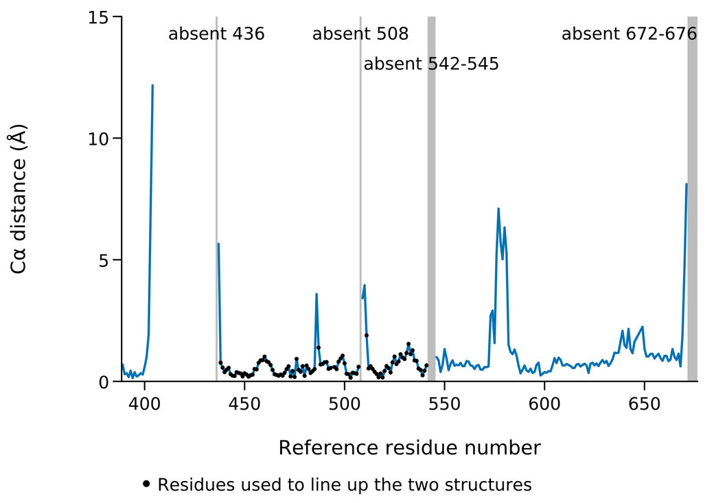

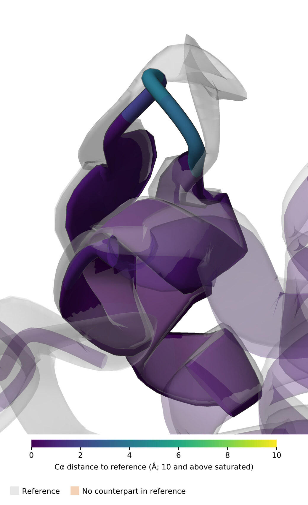

| Numbers | 2BBT | 2BBS |
|---|---|---|
| Residues in the case | 249 | 253 |
| Residues paired | 239 | 243 |
| Residues used for the fit, RMSD | 99, 0.79 Å | 99, 0.66 Å |
| lDDT-Cα | 0.90 | 0.91 |
| Phe508 | absent in the case | absent in the case |
| Gly509, Val510, Ser511 | 3.5, 4.0, 1.6 Å | 3.4, 3.9, 1.9 Å |

- The files hold several copies of NBD1, so **Chains** must be set to `A`. Without it the pairing is not meaningful.
- Residues are paired by their file numbers, because the sequence alignment agrees with them. A residue missing from one file (here Phe508 and some loops) stays unpaired and does not shift the pairing of its neighbors.
- Both case structures carry six other substitutions against the reference (F494N, E550G, Q553R, K555R, Q637R, R667H). They are differences between the constructs, not effects of the deletion.
- Gly509 and Val510 next to the deletion move 3 to 4 Å; the rest of the aligned region stays within about 1 Å. The largest shift (12 Å at Gly404) lies at the start of the construct and is not related to residue 508.
- "Align on residues" excludes the flexible ends and the loop around residue 508 from the fit, so they cannot pull the superposition.

## 2. CFTR full length (5UAK → 8EJ1)

Files: `5UAK.cif`, `8EJ1.cif`. Chains: `A`. Align on residues: `389-678`.

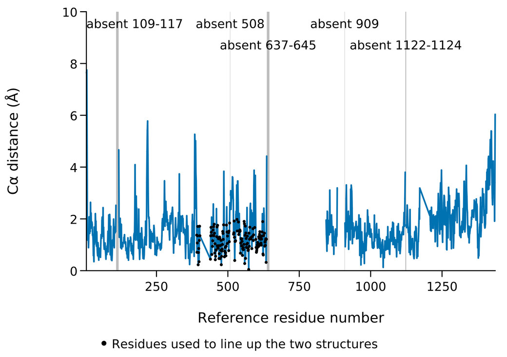

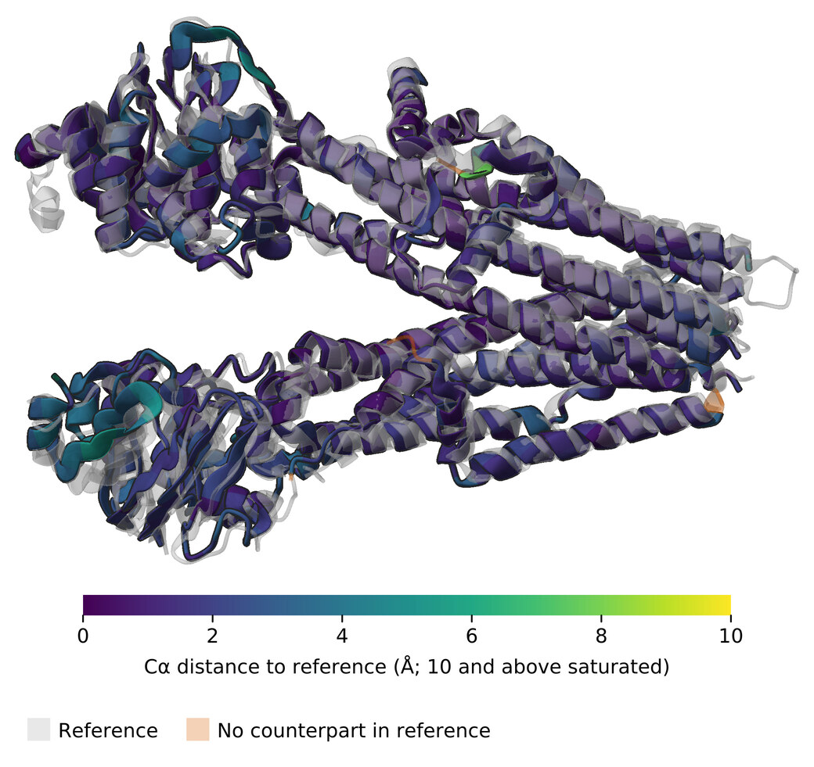

- 1139 reference and 1127 case residues; 1116 are paired. The only substitution is E1371Q.
- Lined up on 165 residues (residues 389 to 678) the RMSD is 1.19 Å; the median shift of all paired residues is 1.4 Å and the largest is 7.7 Å. lDDT-Cα is 0.80.
- 30 secondary-structure changes are listed on the **Residues** tab. Many are short helix ends that change to loops.
- 5UAK has an extra chain of unknown residues; **Chains** `A` keeps CFTR only.
- The run takes about a second on a laptop.

## 3. BRAF kinase V599E (1UWH → 1UWJ)

Files: `1UWH.pdb`, `1UWJ.pdb` (plain PDB format). Chains: `A`. Mark residues: `599`.

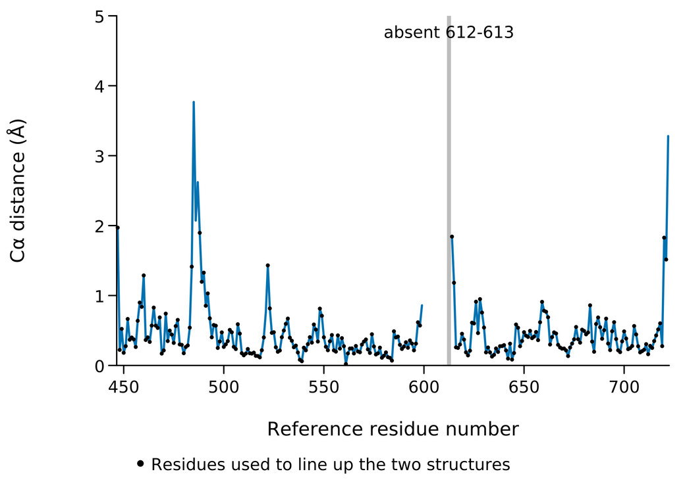

- 264 residues in each file; 262 paired; 256 used for the fit (RMSD 0.52 Å); median shift 0.35 Å; largest 3.8 Å; lDDT-Cα 0.95.
- Residue 599 is Val in the reference and Glu in the case, and it stays in place (0.9 Å). The backbone of the kinase domain differs little from the reference.
- The two files hold different disordered pieces: residues 612 and 613 exist only in the reference, residues 600 and 601 only in the case. Pairing by file numbers keeps the rest of the chain correct; FoldShift lists both pieces under absent and new residues.
- The substitution list in the distance table also shows A521K, a second difference between the two constructs.

## 4. KRAS G12D (4OBE → 5US4)

Files: `4OBE.pdb`, `5US4.pdb`. Chains: `A`. Mark residues: `12`.

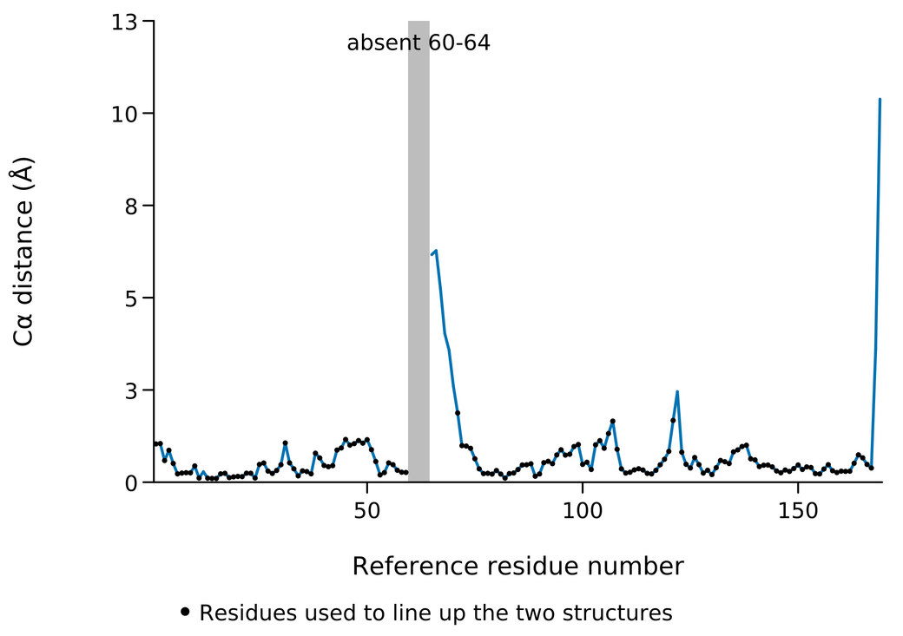

- 169 reference and 164 case residues; all 164 case residues are paired; 154 used for the fit (RMSD 0.62 Å); lDDT-Cα 0.94.
- Residues 60 to 64 (switch II) are missing from the case and are shown as a gray band. The two aligned blocks, 1 to 59 and 65 to 169, are fitted separately on the **Regions** tab (local RMSD 0.48 and 1.57 Å).
- Gly12 becomes Asp12 and moves 0.3 Å. The backbone around residue 12 hardly moves.
- The largest shift is at the C-terminal residue Lys169 (10.4 Å), a flexible end.
- The reference 4OBE carries Gly at residue 12 in this file. Check the construct in the PDB entry before you call it wild type.

## 5. Hemoglobin β-chain E6V (2HHB → 2HBS)

Files: `2HHB.cif`, `2HBS.cif`. Chains: `B`. Mark residues: `6`.

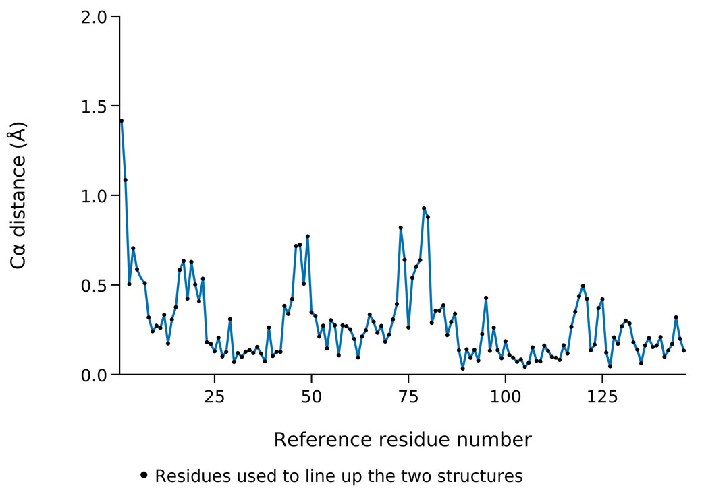

- Both entries hold the α and β chains of a tetramer (or two). **Chains** `B` keeps the β chain, 146 residues in each file.
- Glu6 becomes Val6 and moves 0.5 Å. The fit uses 145 residues (RMSD 0.36 Å); the largest shift is 1.4 Å; lDDT-Cα is 0.99.
- The backbone of the β chain is almost unchanged. A single-chain Cα comparison does not show contacts between molecules.

## 6. p53 core domain Y220C (2OCJ → 2J1X)

Files: `2OCJ.cif`, `2J1X.cif`. Chains: `A`. Mark residues: `220`.

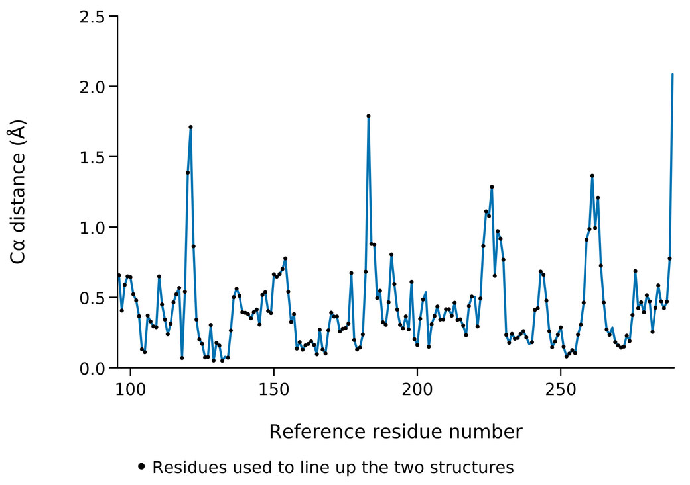

- 194 reference and 195 case residues; 188 used for the fit (RMSD 0.52 Å); largest shift 2.1 Å; lDDT-Cα 0.98.
- Five substitutions separate the two files: M133L, V203A, Y220C, N239Y, N268D. Y220C is the variant of interest; the other four are differences between the constructs. The summary lists them all, so you can see which differences are not the variant.
- Tyr220 becomes Cys220 and moves 0.5 Å. A Cα distance does not show changes of the side chain.

## 7. T4 lysozyme L99A (1L63 → 1L90 and 2B6Z)

Files: `1L63.pdb`, `1L90.pdb`, `2B6Z.pdb`. Drop `1L63.pdb` as the reference and the other two together as cases. Mark residues: `99`.

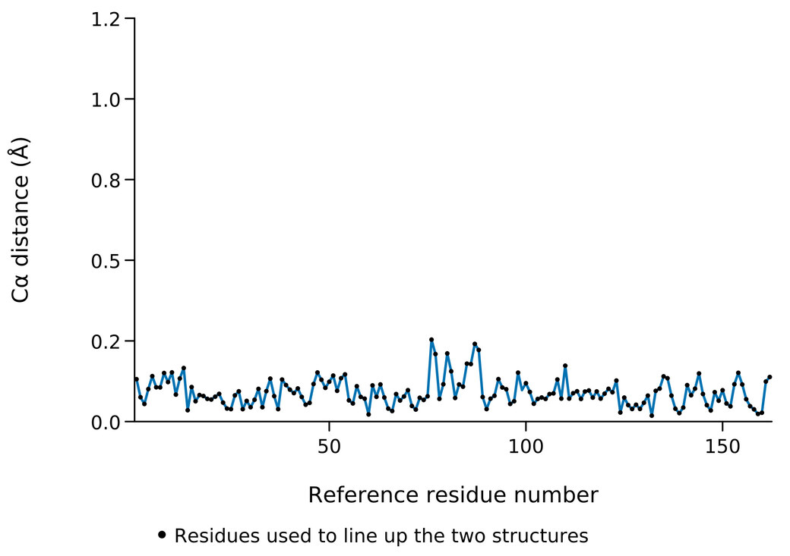

| Case | Fit RMSD (residues) | Largest shift | lDDT-Cα |
|---|---|---|---|
| 1L90 | 0.10 Å (161) | 0.3 Å | 1.00 |
| 2B6Z | 0.14 Å (161) | 0.3 Å | 1.00 |

- One reference gives two result blocks. The reference file is read once.
- The Cα trace of the three structures is the same within 0.3 Å. A small Cα shift does not mean that a substitution has no effect.
- The third structure of the original list, 3FA0, is an R96H mutant and does not serve as a second wild type, so 2B6Z replaces it.

## 8. H-NOX A71G (6BDD → 6BDE)

Files: `6BDD.pdb`, `6BDE.pdb`. Chains: not needed (one chain each). Mark residues: `71`.

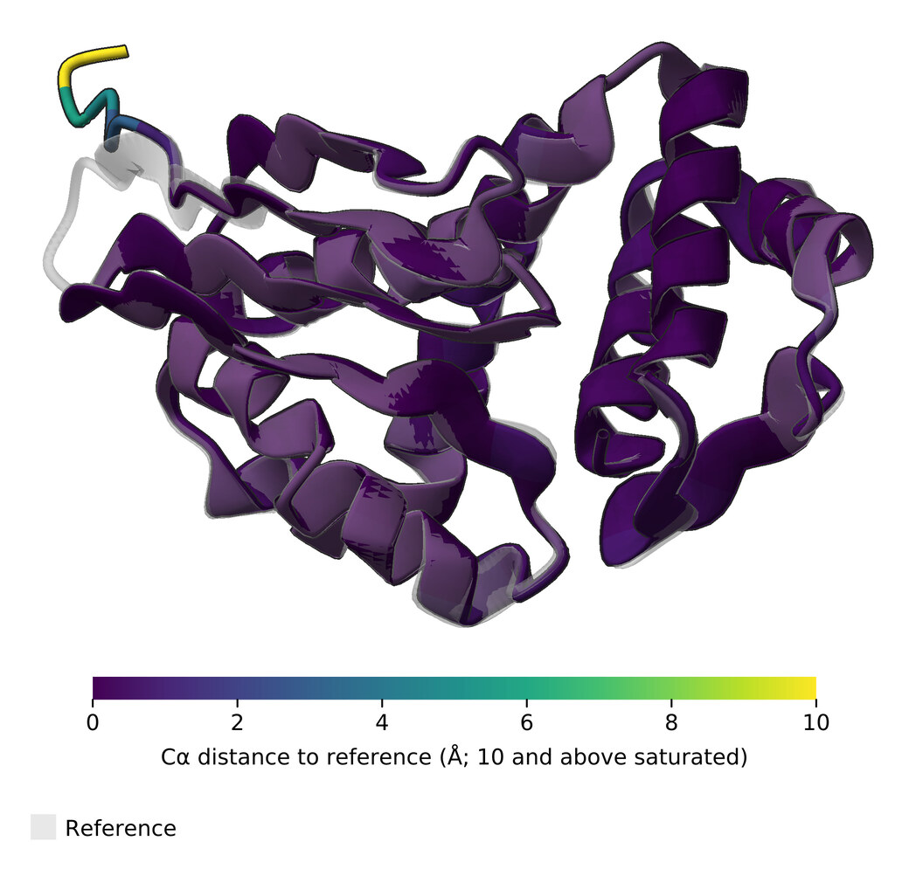

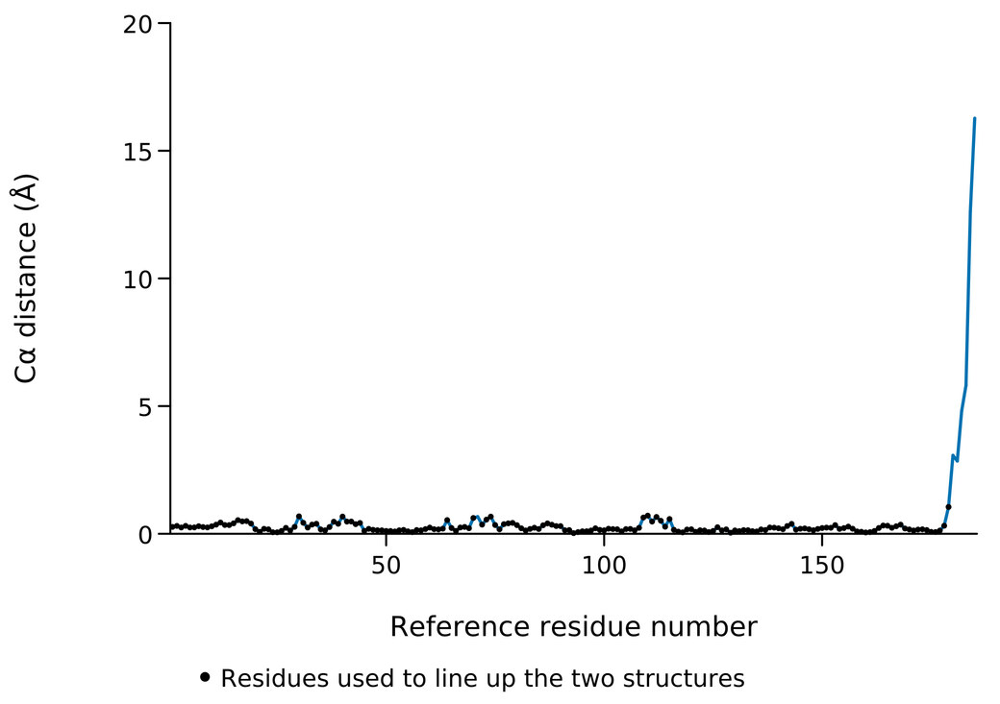

- 185 residues in each file; 178 used for the fit (RMSD 0.29 Å); median shift 0.2 Å; lDDT-Cα 0.97.
- Ala71 becomes Gly71 and moves 0.7 Å.
- The last residues move a lot (Gln185 16.3 Å, Phe184 12.6 Å). The share of residues above 5 Å is 2 %, all of them at the C-terminal end. Use **Rotate** to see how the end swings away from the domain, and the **Residues** tab for the strand-to-loop change at 176 to 180.

## Settings used

| Example | Chains | Align on residues | Zoom on residues | Mark residues |
|---|---|---|---|---|
| 1 | `A` | `437-507, 509-541` | `500-520` | `508, 509, 510, 511` |
| 2 | `A` | `389-678` | none | none |
| 3 | `A` | automatic | none | `599` |
| 4 | `A` | automatic | none | `12` |
| 5 | `B` | automatic | none | `6` |
| 6 | `A` | automatic | none | `220` |
| 7 | none | automatic | none | `99` |
| 8 | none | automatic | none | `71` |

Figures are the 88 mm JPEG files of the app, reduced for this page.
